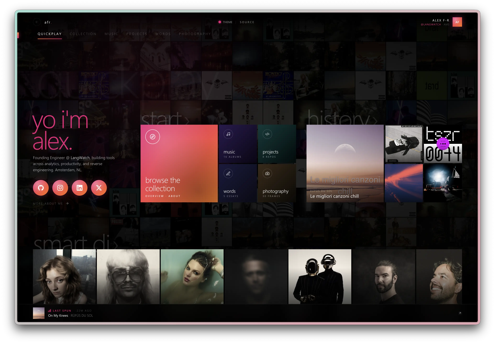

# alex.forbes.red

personal site, super serious.



Forbesoft Windows xp: an XP-inspired desktop with Zune for quickplay, music
and the media collection; Messenger for the profile; Picture & Fax Viewer for
photography; Word 2003 for writing; Explorer and Digital Creativity for projects.
Messenger is the main profile; Zune also shows that profile and the photo collection. Drag, resize, minimize and
maximize windows, or reopen them from Start and the taskbar.

Canal Cadet is an original Three.js 3D pinball game about Amsterdam night rides:
three balls, working flippers, charged launches, a raised playable wire ramp, lit bumpers, multiball
targets and a saved high score. Use arrow keys or Z/slash for flippers, hold
Space to launch, and P to pause. Touch controls are available too. The club ramp opens a 15-second phase: gold PEP surfaces give 250 points and faster, enlarged flippers; violet KETA surfaces give 1,000 points. Three KETA hits trigger eight seconds of delayed, slow flippers and chromatic ball trails. The horseshoe adds KETA outside the club too. PEP lanes also activate the ten-second boost. Timers pause with the game and effects reset on a drain.

Phones use a Windows Phone 8-inspired Start screen, tiles, app list and
Back/Start/Search navigation. Each app has a dedicated Metro interior. See [the content/app map](docs/app-map.md).
Product Name in Digital Creativity selects a side project; Open visits it,
Random selects another, and Play music / Pause music controls a local render
of the original Kenet & Rez tracker module. Exit stops its music.

zune-flavoured pivot nav. albums + artists from stats.fm, likes from
soundcloud, a local photo collection, repo stats from github. pre-rendered
at build time so it lands as a real page, not a spinner.

## stack

Preact + HTM, shared server/client components, CSS, and an esbuild client bundle.
build script is `tsx scripts/build.ts` — pulls every upstream, writes
`data/snapshot.json`, and SSRs every dynamic section into `index.html`
via `<!--ssr:NAME--><!--/ssr-->` markers. cron runs it every 30 minutes
and commits the diff; the push triggers github pages.

## hacking on it

```bash
make help           # list targets
make dev            # local static server on :8765
make build          # full build — hits every upstream
make build-offline  # SSR-only, reuses data/snapshot.json (no api calls)
make build-github   # refresh github stats (after editing content.json)
make check          # typecheck + offline rebuild
```

curated content (projects + essays) lives in `data/content.json` — edit
that by hand. live snapshots (`data/snapshot.json`, `images/albums/`, `images/artists/`) belong to
the cron, leave them alone.

Photography is owned here: edit `data/photos.json` and add files to `images/photos/`.
The manifest order controls the gallery; builds never replace it with a feed.
Use the [add-site-images skill](.agents/skills/add-site-images/SKILL.md) for the
image, metadata, and verification workflow.

The XP welcome screen appears on page load; selecting Visitor opens the desktop without a password. Desktop windows resize from their edges and corners; small screens use the phone shell. Digital Creativity starts its local track on first interaction, with Play music / Pause music controls and a preference saved in localStorage. Its spectrum reads the track through Web Audio; reduced-motion mode keeps the visualiser still and skips the login animation.
